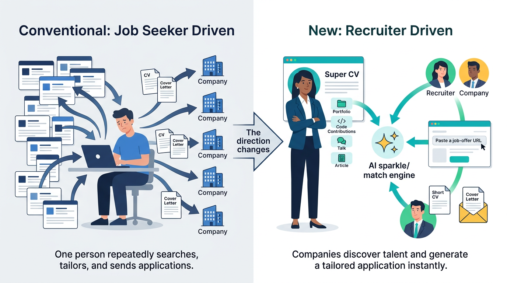

This idea turns job applications around: instead of people always searching and applying for jobs, companies can create a tailored application for a person they already want to hire.

## New business idea: Job-Application Self-Service for Companies

We are currently thinking about a public WebService where experts who are open for work may upload their SuperCV once, so that RECRUITERS and COMPANIES then can give in their JobOffer-URLs to compile the potential candiate's AI-customized job-application documents permissenles by themselves whenever they want.

Life **example**: On LinkedIn I am sharing a link to my personal Homepage, where a recruiter, who has stumbles over my name, can without my permission nor attention just drops his job-offer's URL and his eMail and within seconds will get my CUSTOMIZED Short-CV and CoverLetter demonstrating best fit or not directly into his inbox.

So it is no longer the job-seeker looking for companies to apply, but companies self-generating customized job-appliances for persons they just got aware for being potential candidates: upon public contributions in terms of workshops given, podcasts, shared code, excellent social media contributions, articles, projects or ad hoc wherever interesting people are met.

The key idea behind this is, that for the best match, the probability that a company finds promising candidates upon their currently active real world contributions and impact with much higher precision for a real match, than by waiting for a dream candiate guessing in the wild where to apply and who might never get your (young) company onto his or her radar.

As a side effect the company might test serveral open positions against the same candiate or might just test their job-offer-content whether it will trigger the "right" response with specific "target" candiates in mind offering this service on their homepage. "

## Simple version
Imagine you have one online “super résumé” that contains your skills, projects, experience, and what kind of work you enjoy.

You share a link to it on your website, LinkedIn, GitHub, or social-media profile. If a recruiter discovers you and thinks, “This person could be great for our company,” they can paste their job-ad link into a website.

Within seconds, AI checks how well you fit that specific job and sends the recruiter:

A short résumé focused on the skills relevant to that role

A customized cover letter explaining why you could be a good match

An honest indication if the job does—or does not—fit you well

Why it matters
Many talented people never apply to excellent jobs because they do not know the company exists, are busy doing great work, or do not want to repeatedly rewrite the same application documents.

At the same time, companies often struggle to find the right people through normal job ads.

This service helps companies discover people through what they already do publicly—such as building software, giving talks, creating art, publishing articles, or sharing projects—and then quickly check whether a real job match exists.

In short: companies can apply to candidates, rather than candidates always applying to companies.